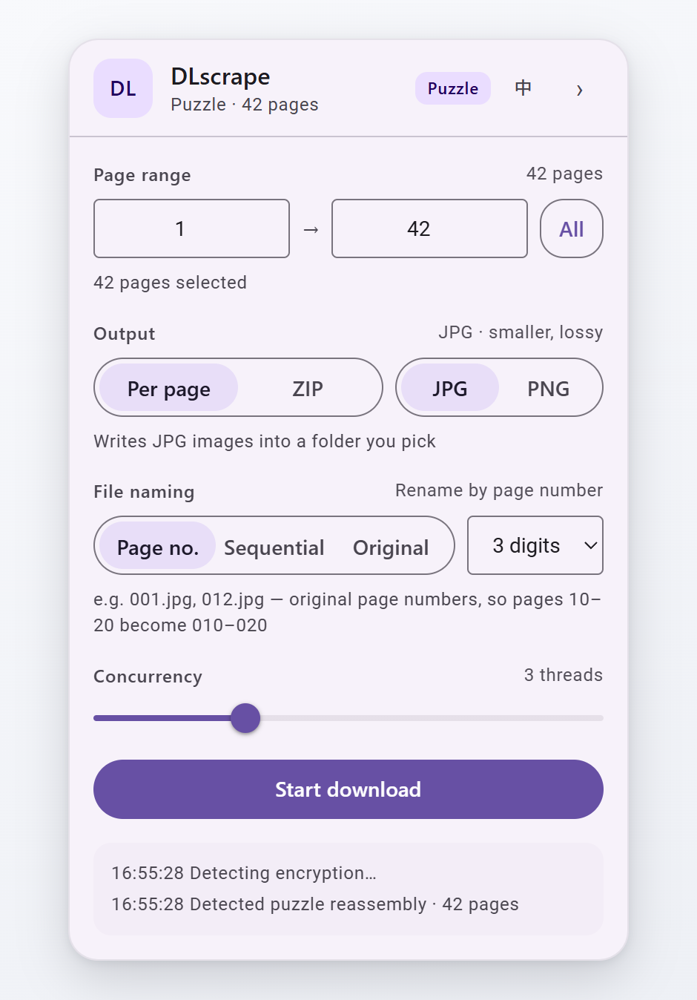
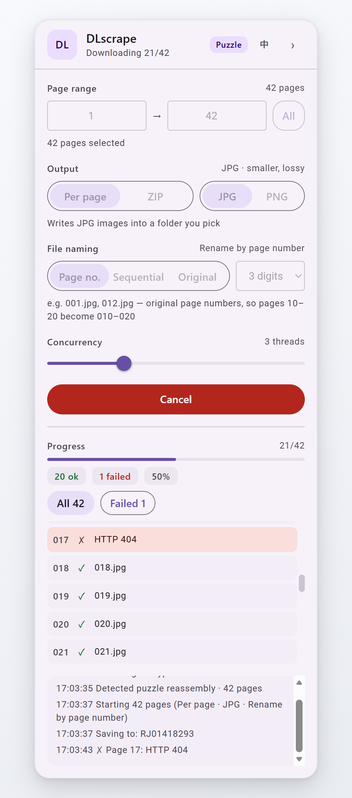
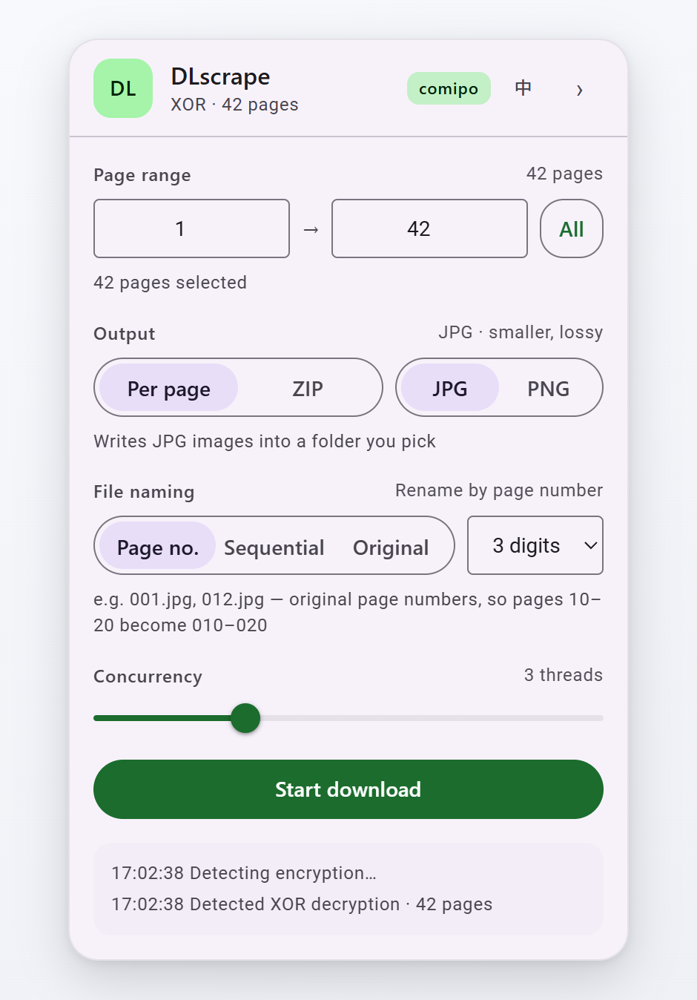

# DLscrape

**[中文](README.md)** · A browser userscript that downloads manga from DLsite Play (including Comipo).

On a work's reading page it detects the encryption scheme (XOR / puzzle tiles) automatically, then downloads the pages **you have purchased**, decrypts and reassembles them, and saves them as images or a single ZIP.

> The panel itself speaks both Chinese and English — use the **EN / 中** button in the title bar, or let it follow your browser language.

> An improved fork of **cpufan's** [DLsite Play Downloader](https://github.com/cpuopt/DLsite-Play-Downloader) v2.2.1 (MIT): the download and decryption core is unchanged, the whole UI was rebuilt, and several gaps in the download experience were closed. Original copyright stays with the upstream author.

## Features

- **Page range** — `Start → End` inputs plus an "All" button with a live count of selected pages; large works can be fetched partially.
- **Per-page files or one ZIP** — per-page mode writes straight into the folder you pick (`showDirectoryPicker`, no hundreds of download prompts), or everything is packed into a single ZIP.
- **JPG / PNG** — two sliders control output mode and image format independently.
- **Three naming schemes** — `page` keeps the original page numbers (fetching pages 10–20 gives `010.jpg`–`020.jpg`), `seq` renumbers from `001` in download order, `original` keeps DLsite's own filename; digit width 2–5.
- **Progress and detail** — progress bar, success / failure / skipped counters, per-page state with failure reasons, a filterable detail list, a timestamped log, and cancellation at any time.
- **comipo Play** — the same script works inside comipo's reskinned reader; when detected the whole panel switches to a green theme and shows a `comipo` badge.
- **Chinese / English UI** — one button in the title bar switches languages; the panel follows the browser language by default (`zh*` → Chinese, otherwise English) and remembers your choice.
- **Material Design 3** — M3 tokens and colours, 40px controls, pill buttons, segmented sliders, sidebar layout, follows system light/dark.

## Install

1. Install [Tampermonkey](https://www.tampermonkey.net/) or Violentmonkey.
2. Install from the raw URL: `https://github.com/operLin/DLscrape/raw/main/DLscrape.user.js`
3. Open a work's reading page; the panel on the right detects the encryption scheme and lists the page count.

> If you also run the upstream original, disable it first — both inject a panel.

## Screenshots

**Downloading** — progress bar, success / failure / skipped counters, per-page state and failure reasons.

**comipo Play** — when comipo is detected the whole panel switches to a green theme with a `comipo` badge.

*Real rendering of the panel; the sample data is mocked locally.*

## How it is built

Upstream only publishes a compiled artifact (a SystemJS bundle built with Vite + vite-plugin-monkey), with no TypeScript + Vue SFC sources. This fork therefore keeps its changes as standalone slices in `build/parts/*.js` and reassembles them into the original bundle by line range via `build/apply.mjs`:

- every slice's **first line is content-asserted** before replacement, so line-number drift fails loudly instead of silently patching the wrong spot;
- the upstream artifact in `upstream/` stays byte-identical, keeping the build reproducible and reviewable;
- `build/verify.mjs` (72 checks: patch integrity + core behaviour + UI rendering + header metadata) and `build/dom-test.mjs` (35 checks: real Vue + jsdom integration tests) ship with the repo.

Details in [build/README.md](build/README.md).

## Disclaimer

This tool is intended **only for backing up content you have personally purchased or are otherwise authorised to access**. Do not use it for redistribution, secondary distribution, or any commercial purpose. You are responsible for any consequences of using this script, and you must comply with DLsite / Comipo's terms of service and your local laws.

## License

[MIT](LICENSE) — original copyright belongs to **cpufan**; this fork's changes are released under MIT as well.