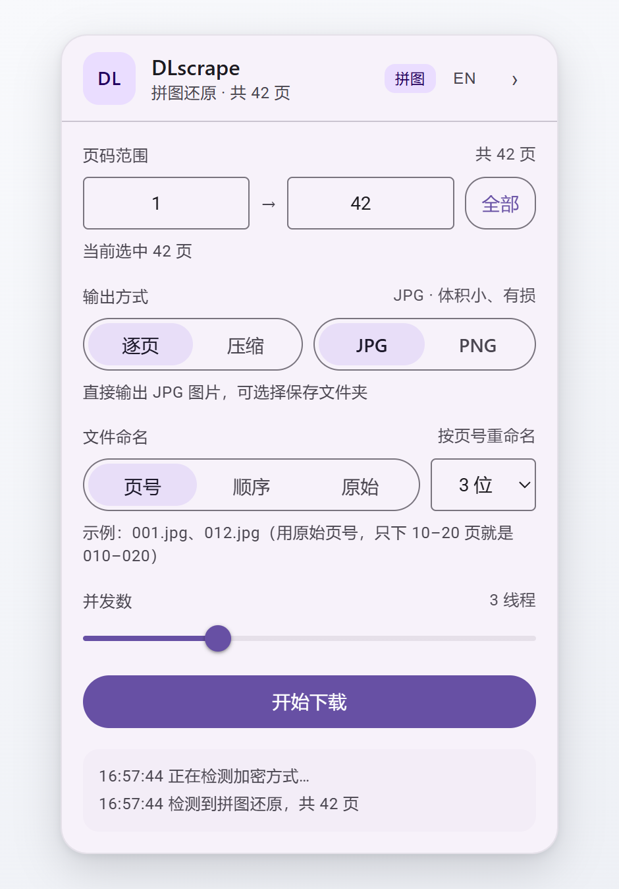
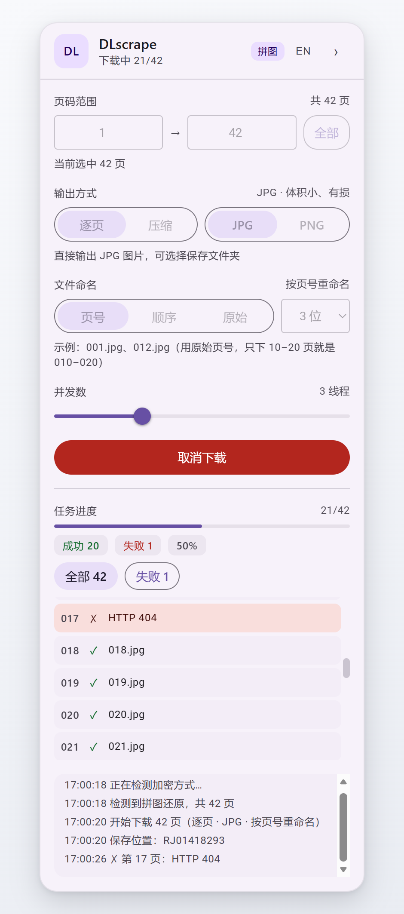
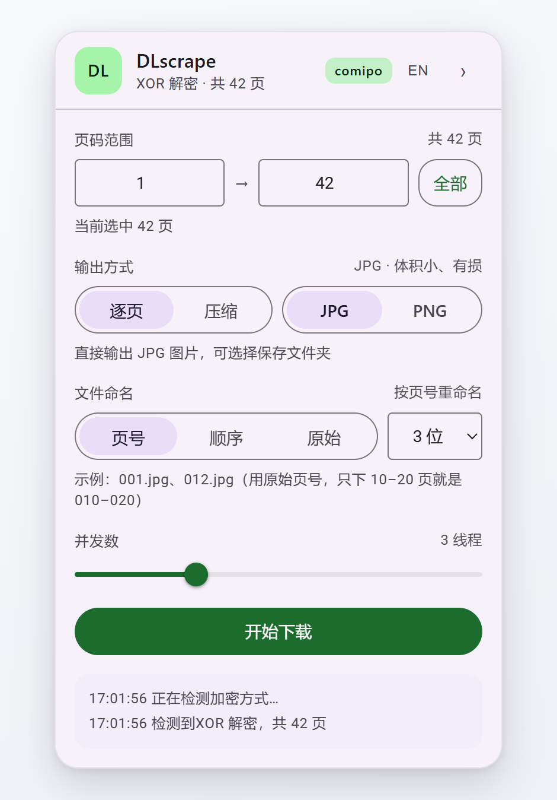

# DLscrape

**[English](README.en.md)** · DLsite Play（含 Comipo）漫画下载器 —— 浏览器用户脚本。

在 DLsite Play / comipo Play 的作品阅读页自动识别加密方式（XOR / 拼图），把**你已购买**的漫画按页号下载、解密还原，保存为图片或一个 ZIP。

> 基于 **cpufan** 的 [DLsite Play Downloader](https://github.com/cpuopt/DLsite-Play-Downloader) v2.2.1（MIT）改进：下载与解密内核保持不变，重做了整套界面，并补上几个下载体验上的短板。原始版权归原作者所有。

## 功能

- **页码范围** —— `起始 → 结束` 两个输入框 +「全部」按钮，实时显示选中页数；长篇作品可以只下一部分。
- **逐页 / 压缩包** —— 逐页模式直接写入你选定的文件夹（`showDirectoryPicker`，不再弹出几百次下载提示），或打包成一个 ZIP 一次性保存。
- **JPG / PNG** —— 两组滑块分别控制输出方式与图片格式。
- **三种文件命名** —— `页号` 保留原始页号（只下 10–20 页就是 `010.jpg`–`020.jpg`）、`顺序` 按本次下载从 `001` 重排、`原始` 保留 DLsite 原名；位数可选 2–5。
- **进度与明细** —— 进度条、成功 / 失败 / 跳过计数、逐页状态与失败原因、可筛选明细列表、带时间戳日志，随时取消。
- **comipo Play** —— 同一脚本也能在 comipo 的换皮阅读器里工作，检测到后整套面板切换为绿色主题并显示 `comipo` 徽章。
- **中英文界面** —— 标题栏一枚按钮即可切换中英文，默认跟随浏览器语言（`zh*` → 中文，其余 → English），选择会被记住。
- **Material Design 3** —— M3 配色与 token、40px 控件、胶囊按钮、分段滑块、侧边栏形态，深浅色跟随系统。

## 安装

1. 安装 [Tampermonkey](https://www.tampermonkey.net/) 或 Violentmonkey。
2. 打开 raw 链接安装脚本：`https://github.com/operLin/DLscrape/raw/main/DLscrape.user.js`
3. 打开作品阅读页，右侧面板会自动检测加密方式并列出页数。

> 若同时装着上游原版，建议先禁用原版：两者会各自注入一个面板。

## 界面

**下载中** —— 进度条、成功 / 失败 / 跳过计数，逐页状态与失败原因一目了然。

**comipo Play** —— 检测到 comipo 后整套面板换成绿色主题，并显示 `comipo` 徽章。

*截图为面板真实渲染，示例数据为本地模拟。*

## 实现要点

上游只发布编译产物（Vite + vite-plugin-monkey 打的 SystemJS bundle），没有 TS + Vue SFC 源码，所以本仓库把改动保存为 `build/parts/*.js` 独立片段，用 `build/apply.mjs` 按行区间拼回原始 bundle：

- 每段替换前对**起始行做内容断言**，行号漂移时直接报错，而不是静默改错位置；
- 上游产物 `upstream/` 始终字节不变，构建可复现、可 review；
- `build/verify.mjs`（68 项：拼接完整性 + 内核行为 + UI 渲染 + 头部元数据）与 `build/dom-test.mjs`（32 项：真实 Vue + jsdom 集成测试）随仓库提供。

细节见 [build/README.md](build/README.md)。

## 免责声明

本工具仅用于**备份你本人已购买或已获得授权的内容**，请勿用于传播、二次分发或任何商业用途。使用者需自行承担因使用本脚本产生的一切后果，并遵守 DLsite / Comipo 的服务条款与当地法律。

## License

[MIT](LICENSE) —— 原始版权归 **cpufan** 所有，本 fork 的修改部分同样以 MIT 发布。